# Relatório visual dos resultados

<!-- legenda-interna-projeto -->
## Legenda de nomes e abreviações do projeto

| Nome / abreviação | Significado nesta documentação |
| --- | --- |
| **SEM** / **SEM_BLOQUEIO** | **Sem bloqueio como alvo de classificação**: modelo treinado para reconhecer as extrasístoles compartilhadas entre MIT e LUDB. Bloqueios não são alvos positivos dessa política. O nome não garante ausência de bloqueios como comorbidade em todo registro. |
| **COM** / **COM_BLOQUEIO** | **Com bloqueio como alvo de classificação**: modelo que inclui extrasístoles e bloqueios de ramo completos e incompletos entre seus alvos positivos. |
| **COM somente completos** | Recorte de avaliação do mesmo modelo COM: exclui apenas positivos cuja única justificativa seja bloqueio incompleto. Mantém extrasístoles associadas a incompletos; não é um terceiro modelo. |
| **BEST** / **LAST** | BEST é o checkpoint da melhor época pela Balanced Accuracy da validação MIT; LAST é o da última época. Checkpoint significa o arquivo com os pesos e metadados do modelo. |
| **BA** | Balanced Accuracy, ou acurácia balanceada: média entre sensibilidade e especificidade. |
| **Política / slug** | Regra de seleção dos alvos e seu identificador nos arquivos: shared-extrasystoles-v1 = SEM; shared-extrasystoles-bbb-v1 = COM. |
| **beat / beat_id / n** | Beat é a janela de um batimento; beat_id é seu identificador; n é a quantidade de exemplos do recorte. As classes 0 e 1 são, respectivamente, referência negativa e alvo positivo da política. |

Esta legenda esclarece a nomenclatura interna atual. Em documentos marcados **HISTÓRICO**, não substitui nem atualiza as regras antigas descritas no corpo. As siglas médicas mantêm a nomenclatura dos dados originais.
<!-- /legenda-interna-projeto -->

STATUS: ATUAL — apresentação da execução final existente, revisada em 30/10/2026. Figuras de apresentação geradas de CSV/JSON/NPZ salvos; painéis Grad-CAM extraídos dos notebooks finais sem alterar pixels. Nenhum modelo, mapa ou IoU foi recalculado.

## 1. Visão geral

## 2. Treinamento SEM — BEST época 2

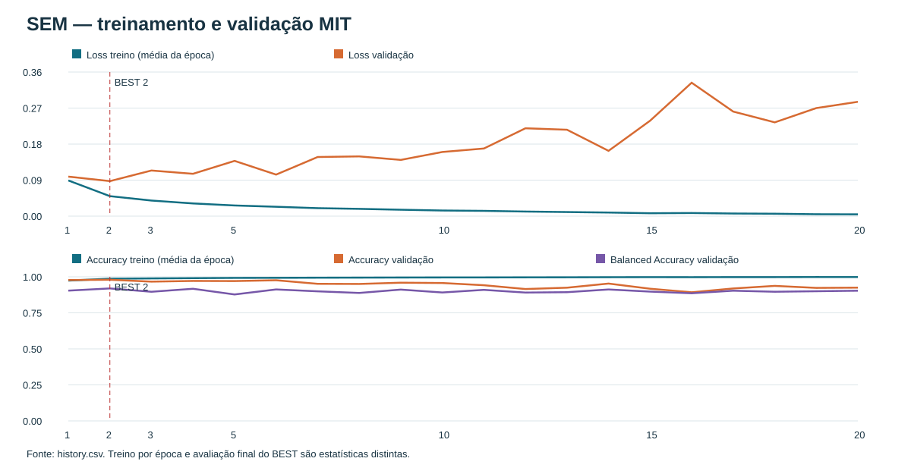

## 3. Treinamento COM — BEST época 3

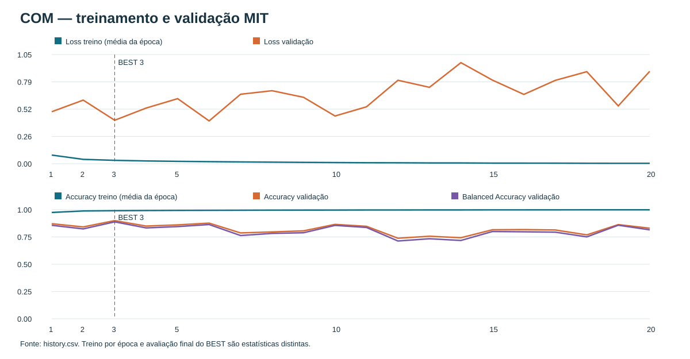

A validação termina pior apesar da redução da loss de treino. O BEST foi selecionado somente no MIT.

## 4. Matrizes MIT

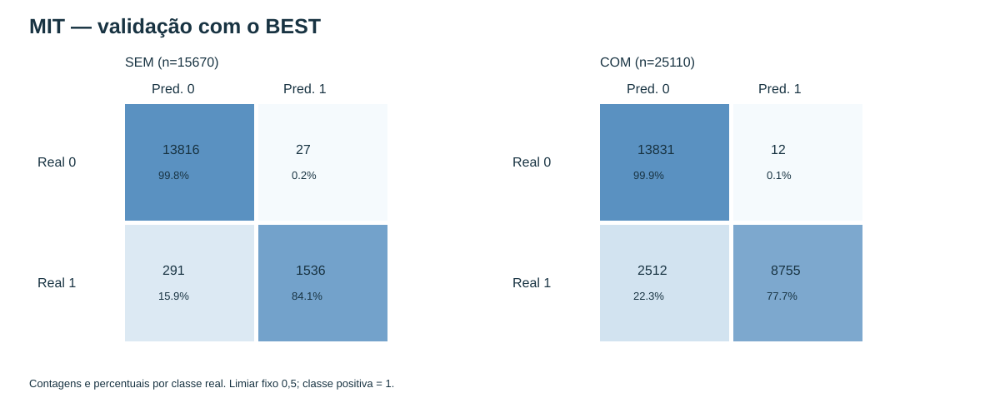

## 5. Matrizes LUDB

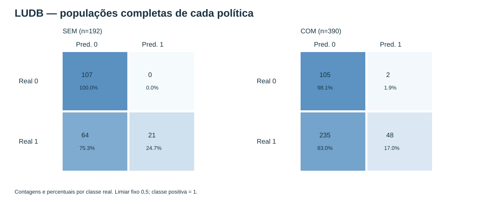

## 6. Métricas principais

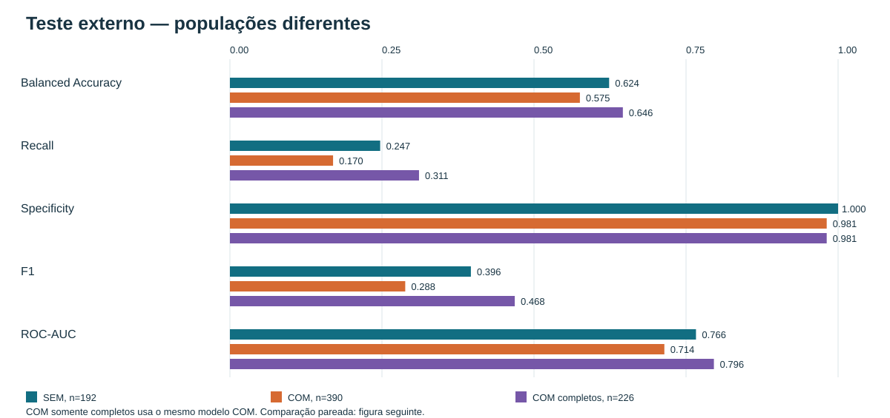

| Avaliação | n | Accuracy | BA | Precision | Recall | Specificity | F1 | ROC-AUC | TN | FP | FN | TP |
| --- | --- | --- | --- | --- | --- | --- | --- | --- | --- | --- | --- | --- |
| SEM, n=192 | 192 | 0.6667 | 0.6235 | 1.0000 | 0.2471 | 1.0000 | 0.3962 | 0.7664 | 107 | 0 | 64 | 21 |
| COM, n=390 | 390 | 0.3923 | 0.5755 | 0.9600 | 0.1696 | 0.9813 | 0.2883 | 0.7143 | 105 | 2 | 235 | 48 |
| COM completos, n=226 | 226 | 0.6283 | 0.6461 | 0.9487 | 0.3109 | 0.9813 | 0.4684 | 0.7958 | 105 | 2 | 82 | 37 |

As três avaliações acima têm populações diferentes; somente a figura seguinte compara modelos nos mesmos beats. COM somente completos usa o mesmo checkpoint COM.

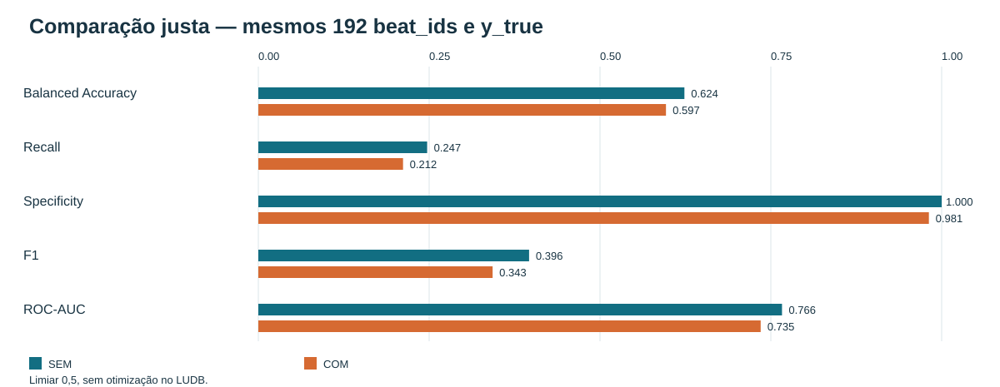

| Grupo | 0→0 | 0→1 | 1→0 | 1→1 |
| --- | --- | --- | --- | --- |
| todos | 169 | 2 | 3 | 18 |
| negativos | 105 | 2 | 0 | 0 |
| atrial_extrasystole | 27 | 0 | 3 | 6 |
| ventricular_extrasystole | 37 | 0 | 0 | 12 |

## 7. Completos e incompletos

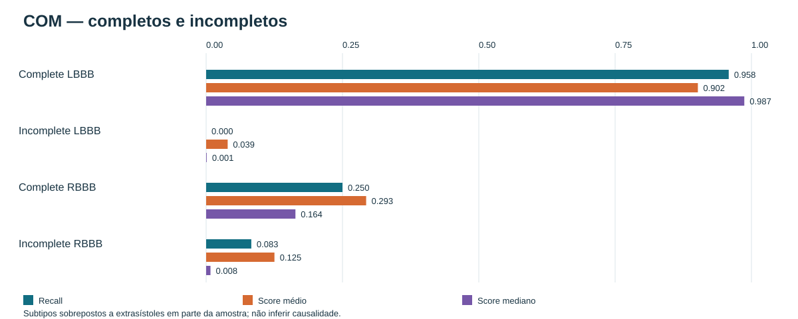

| Subtipo | Beats | Registros | TP | FN | Recall | FNR | Score médio | Score mediano |
| --- | --- | --- | --- | --- | --- | --- | --- | --- |
| Complete LBBB | 24 | 4 | 23 | 1 | 0.9583 | 0.0417 | 0.9018 | 0.9869 |
| Incomplete LBBB | 24 | 3 | 0 | 24 | 0.0000 | 1.0000 | 0.0395 | 0.0010 |
| Complete RBBB | 24 | 3 | 6 | 18 | 0.2500 | 0.7500 | 0.2934 | 0.1637 |
| Incomplete RBBB | 157 | 26 | 13 | 144 | 0.0828 | 0.9172 | 0.1252 | 0.0079 |

## 8. Origem dos falsos negativos

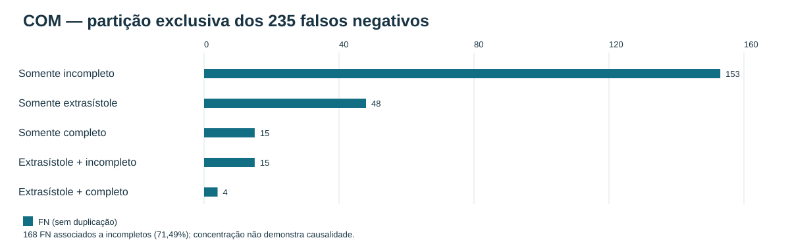

| Grupo exclusivo | Positivos | FN |
| --- | --- | --- |
| Somente incompleto | 164 | 153 |
| Somente extrasístole | 54 | 48 |
| Somente completo | 34 | 15 |
| Extrasístole + incompleto | 17 | 15 |
| Extrasístole + completo | 14 | 4 |

Categorias exclusivas somam 235. Associados a incompletos: 168/235 (71,49%), incluindo sobreposições. Concentração não prova causalidade.

## 9. Grad-CAM já existente

Os painéis abaixo são os PNGs originais do notebook 05. Critério reproduzível do notebook: score máximo nos quadrantes VP/FP e mínimo nos quadrantes VN/FN; empate preserva o primeiro índice. Exemplos extremos não representam a frequência dos casos. Scores da tabela: valores do Grad-CAM salvo, com o mesmo criterio do painel; diferenca maxima de 2,116e-6 em relacao ao teste.

O Grad-CAM indica regiões que mais influenciaram a saída do modelo. Os mapas se referem à saída positiva, inclusive nos negativos; não são prova clínica nem localização de doença.
### SEM

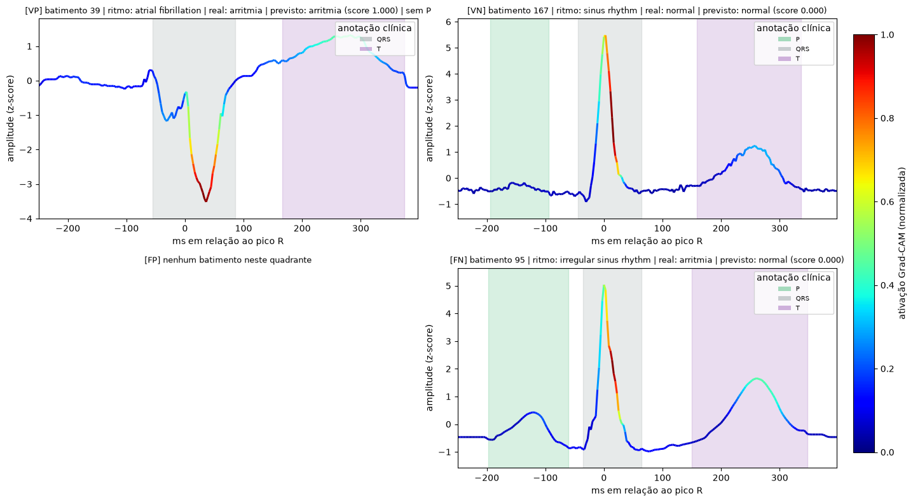

| Quadrante | record_id | beat_id | y_true | y_pred | Score | Família/subtipo |
| --- | --- | --- | --- | --- | --- | --- |
| VP | 83 | ludb:1.0.1:83:ii:r867:w90-144:sel2 | 1 | 1 | 0.9999732 | ventricular_extrasystole / Ventricular extrasystole, localisation: lvot, lvs; Ventricular extrasystole, morphology: polymorphic; Ventricular extrasystole, type: couplet; Ventricular extrasystole, type: single pvc |
| VN | 193 | ludb:1.0.1:193:ii:r1138:w90-144:sel1 | 0 | 0 | 0.00008143176 |  / negative_reference |
| FP | — | — | — | — | — | Quadrante vazio |
| FN | 132 | ludb:1.0.1:132:ii:r1959:w90-144:sel3 | 1 | 0 | 0.000005133665 | atrial_extrasystole / Atrial extrasystole, type: allorhythmic pattern; Atrial extrasystole, type: bigemini; Atrial extrasystole: sa-nodal extrasystole |

### COM

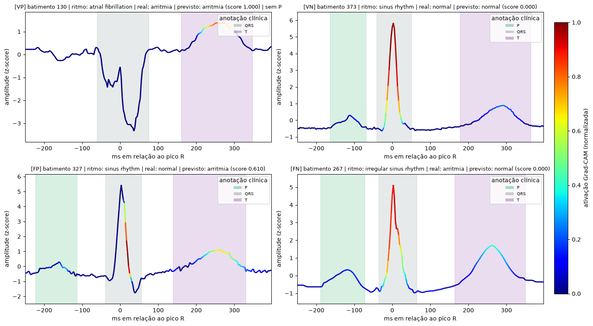

| Quadrante | record_id | beat_id | y_true | y_pred | Score | Família/subtipo |
| --- | --- | --- | --- | --- | --- | --- |
| VP | 83 | ludb:1.0.1:83:ii:r2975:w90-144:sel6 | 1 | 1 | 0.9999976 | lbbb + ventricular_extrasystole / Complete left bundle branch block; Ventricular extrasystole, localisation: lvot, lvs; Ventricular extrasystole, morphology: polymorphic; Ventricular extrasystole, type: couplet; Ventricular extrasystole, type: single pvc |
| VN | 195 | ludb:1.0.1:195:ii:r1364:w90-144:sel2 | 0 | 0 | 0.000007099898 |  / negative_reference |
| FP | 166 | ludb:1.0.1:166:ii:r950:w90-144:sel0 | 0 | 1 | 0.6104141 |  / negative_reference |
| FN | 132 | ludb:1.0.1:132:ii:r2691:w90-144:sel5 | 1 | 0 | 2.724794e-7 | atrial_extrasystole / Atrial extrasystole, type: allorhythmic pattern; Atrial extrasystole, type: bigemini; Atrial extrasystole: sa-nodal extrasystole |

As tabelas identificam os subtipos efetivamente presentes nesses painéis. Não foi inventado um painel para cada um dos quatro bloqueios. Os resultados por subtipo estão no gráfico e na tabela da seção 7.

## 10. IoU visual

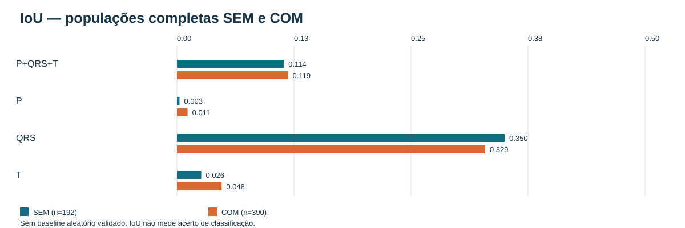

| Modelo/população | IoU geral | P | QRS | T |
| --- | --- | --- | --- | --- |
| SEM — n=192 | 0.1141 | 0.0027 | 0.3501 | 0.0259 |
| COM — n=390 | 0.1186 | 0.0114 | 0.3292 | 0.0477 |

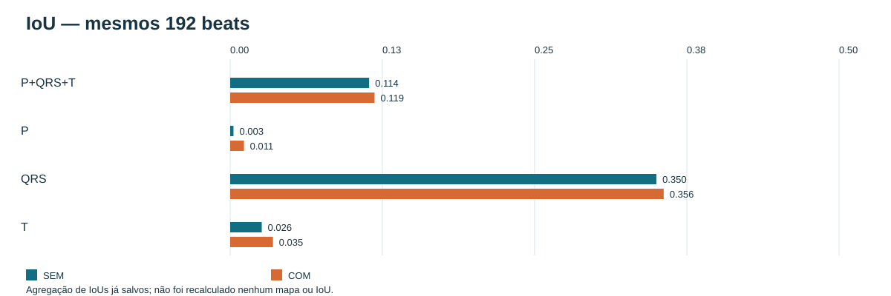

| Modelo — mesmos 192 | IoU geral | P | QRS | T |
| --- | --- | --- | --- | --- |
| SEM | 0.1141 | 0.0027 | 0.3501 | 0.0259 |
| COM | 0.1186 | 0.0113 | 0.3560 | 0.0351 |

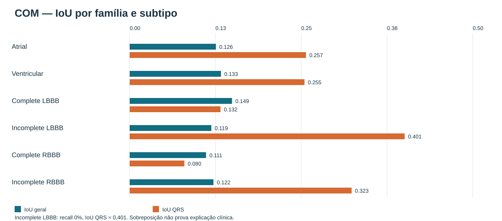

A cobertura clínica ≈ 0,576 não foi validada como baseline aleatório. Nenhuma linha de acaso foi usada nesses gráficos.

## 11. Classificação e explicabilidade

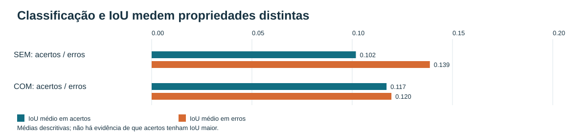

| Modelo | Grupo | n | IoU médio | IoU mediano |
| --- | --- | --- | --- | --- |
| SEM | Acertos | 128 | 0.1018 | 0.0863 |
| SEM | Erros | 64 | 0.1387 | 0.1190 |
| COM | Acertos | 153 | 0.1171 | 0.1103 |
| COM | Erros | 237 | 0.1196 | 0.1103 |

Incomplete LBBB: recall 0% e IoU-QRS médio ≈ 0,401. Isso mostra que acerto binário e sobreposição espacial são propriedades distintas; não valida a explicação.

## Onde encontrar os resultados

### SEM

- [01_exploracao_mitbih.ipynb](outputs/notebooks_executados/shared-extrasystoles-v1/01_exploracao_mitbih.ipynb) — População, símbolos e exemplos MIT.
- [02_exploracao_ludb.ipynb](outputs/notebooks_executados/shared-extrasystoles-v1/02_exploracao_ludb.ipynb) — População, ritmos e máscaras LUDB.
- [03_analise_treino.ipynb](outputs/notebooks_executados/shared-extrasystoles-v1/03_analise_treino.ipynb) — Curvas, BEST e validação MIT.
- [04_teste_ludb.ipynb](outputs/notebooks_executados/shared-extrasystoles-v1/04_teste_ludb.ipynb) — Teste LUDB, erros e distribuições de scores.
- [05_gradcam_demo.ipynb](outputs/notebooks_executados/shared-extrasystoles-v1/05_gradcam_demo.ipynb) — Painéis de Grad-CAM já calculados.
- [06_fidelidade_iou.ipynb](outputs/notebooks_executados/shared-extrasystoles-v1/06_fidelidade_iou.ipynb) — IoU salvo e tabela corrigida de ritmos.

### COM

- [01_exploracao_mitbih.ipynb](outputs/notebooks_executados/shared-extrasystoles-bbb-v1/01_exploracao_mitbih.ipynb) — População, símbolos e exemplos MIT.
- [02_exploracao_ludb.ipynb](outputs/notebooks_executados/shared-extrasystoles-bbb-v1/02_exploracao_ludb.ipynb) — População, ritmos e máscaras LUDB.
- [03_analise_treino.ipynb](outputs/notebooks_executados/shared-extrasystoles-bbb-v1/03_analise_treino.ipynb) — Curvas, BEST e validação MIT.
- [04_teste_ludb.ipynb](outputs/notebooks_executados/shared-extrasystoles-bbb-v1/04_teste_ludb.ipynb) — Teste LUDB, erros e distribuições de scores.
- [05_gradcam_demo.ipynb](outputs/notebooks_executados/shared-extrasystoles-bbb-v1/05_gradcam_demo.ipynb) — Painéis de Grad-CAM já calculados.
- [06_fidelidade_iou.ipynb](outputs/notebooks_executados/shared-extrasystoles-bbb-v1/06_fidelidade_iou.ipynb) — IoU salvo e tabela corrigida de ritmos.

[Guia completo](GUIA_NOTEBOOKS_RESULTADOS.md) · [Relatório geral](RELATORIO_GERAL_PROJETO.md)
